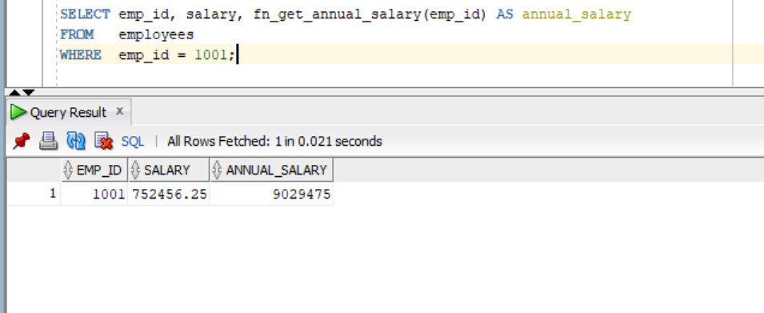
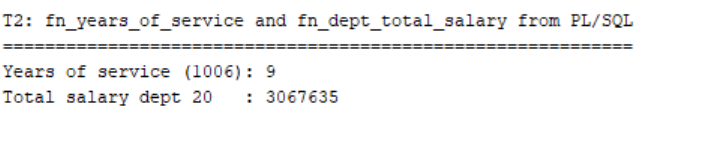
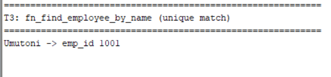
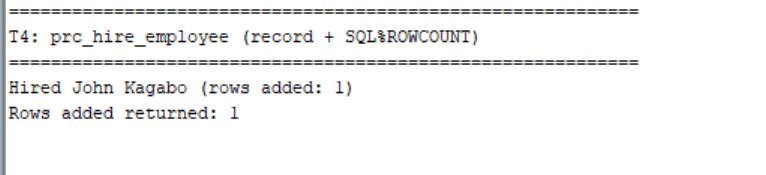
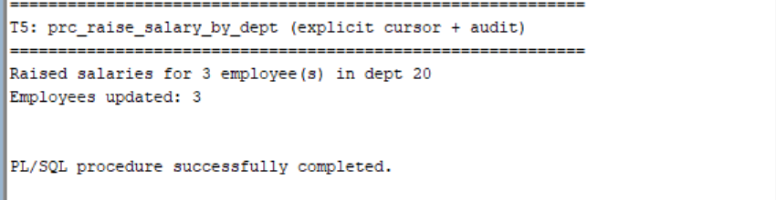
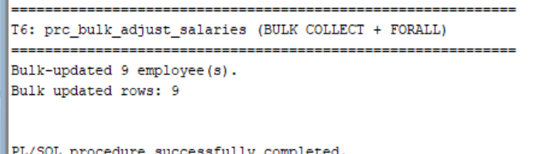
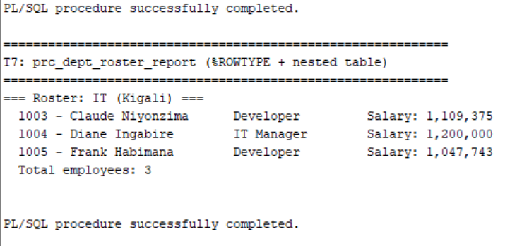
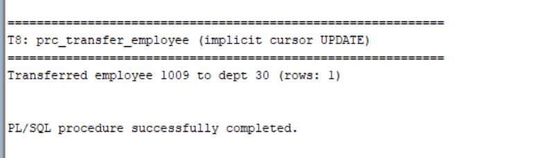
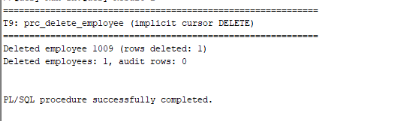
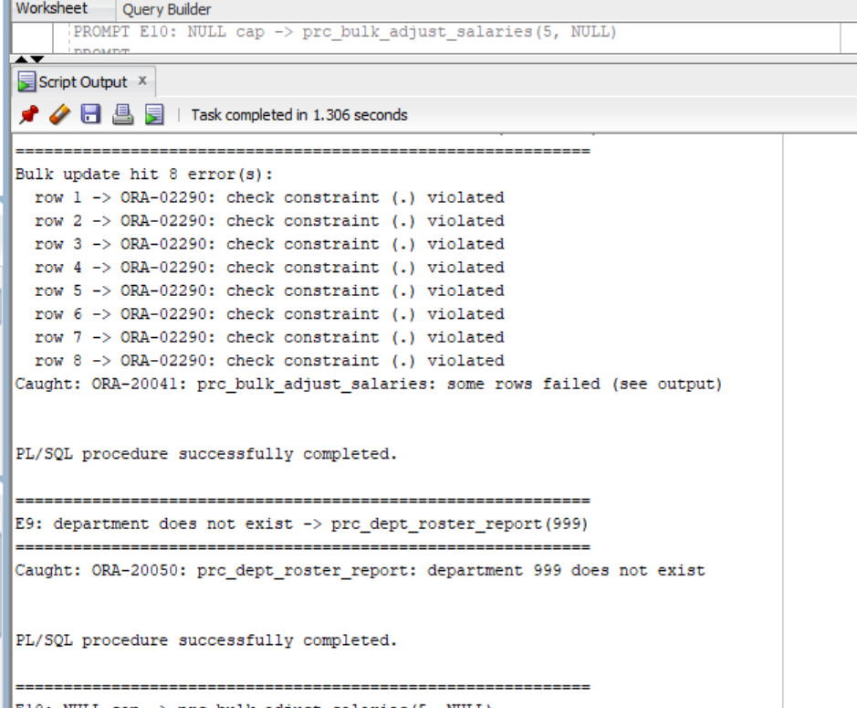

# Group Assignment IV - Advanced Oracle PL/SQL

## Employee Management System

**Course:** Database Development with PL/SQL (INSY 8311)  
**Instructor:** Eric Maniraguha

## Group Members
| Full Name | Student ID |
|---|---|
| Irakiza Blaise | 29289 |
| Ishimwe Zacharie | 28737 |

> Repository name follows the required format: `plsql-assignment4-29289-28737`.

## 1. Application Description and Requirements
This project implements an employee management system in Oracle PL/SQL. The application supports a realistic business case in which a company maintains departments, employees, and salary-change information. The system allows administrators to hire employees, apply salary adjustments, transfer employees between departments, delete employees, and generate department-level reports.

The project is designed to demonstrate the required concepts in Oracle PL/SQL while solving a practical business problem. It uses tables, constraints, procedures, functions, records, collections, cursors, and bulk processing to manage employee data effectively and safely.

### Functional requirements
- Maintain department and employee records with valid constraints
- Hire employees while preventing duplicate IDs and emails
- Adjust salaries by department with validation rules
- Transfer employees between departments
- Delete employees only when valid records exist
- Calculate annual salary and years of service
- Generate department rosters and total salary reports
- Reject invalid input and handle bulk processing failures with clear messages

## 2. Selected Business Scenario
The selected scenario is an employee management system for a small organization. Departments represent organizational units, while employees are assigned to departments. Salary changes are tracked in an audit table to preserve history and support reporting.

This scenario is realistic and well suited to the assignment because it requires stored procedures, functions, records, collections, explicit and implicit cursors, and bulk processing. These features are all essential in practical database development and are directly relevant to real HR systems.

## 3. Database Schema and Design
The database includes the following main tables:

- **departments**
  - `dept_id` (PRIMARY KEY)
  - `dept_name` (UNIQUE, NOT NULL)
  - `location` (DEFAULT `'Kigali'`)

- **employees**
  - `emp_id` (PRIMARY KEY)
  - `first_name`, `last_name` (NOT NULL)
  - `email` (UNIQUE)
  - `hire_date` (DEFAULT `SYSDATE`), `job_title`, `salary`
  - `dept_id` (FOREIGN KEY to `departments`)
  - `salary` must be greater than zero

- **salary_audit**
  - `audit_id` (PRIMARY KEY)
  - `emp_id` (FOREIGN KEY to `employees`)
  - `old_salary`, `new_salary`
  - `change_date`
  - `changed_by`

This design reflects the required one-to-many relationships and uses constraints to enforce data integrity.

## 4. Requirement Coverage Matrix
This project directly addresses each requirement of the assignment:

| Requirement | Demonstrated in project | Evidence |
|---|---|---|
| Records | User-defined records and `%ROWTYPE` are used in procedures and functions | `prc_hire_employee`, `prc_raise_salary_by_dept`, `prc_dept_roster_report` |
| Collections | Associative arrays and nested tables are used to store multiple values or records | `prc_bulk_adjust_salaries`, `fn_dept_total_salary`, `prc_dept_roster_report` |
| Implicit Cursors | `INSERT`, `UPDATE`, and `DELETE` statements use `SQL%ROWCOUNT`, `SQL%FOUND`, and `SQL%NOTFOUND` | `prc_hire_employee`, `prc_transfer_employee`, `prc_delete_employee` |
| Explicit Cursors | `OPEN`, `FETCH`, and `CLOSE` loops are used for row processing | `prc_raise_salary_by_dept`, `fn_dept_total_salary` |
| Bulk Processing | `BULK COLLECT` and `FORALL` are used for efficient multi-row operations | `prc_bulk_adjust_salaries` |
| Stored Procedures | Meaningful procedures with input/output parameters are implemented | `01_procedures/*.sql` |
| Functions | Functions return meaningful business results and are called from SQL/PL/SQL | `02_functions/*.sql` |
| Exception Handling | Predefined exceptions, user-defined exceptions, and `RAISE_APPLICATION_ERROR` are used | All procedures, functions, and tests |
| Practical Application | Real HR scenario implemented with realistic tables and sample data | Employee management system |

## 5. Repository Structure
```text
00_schema/
    01_create_tables.sql
    02_insert_sample_data.sql

01_procedures/
    prc_hire_employee.sql
    prc_raise_salary_by_dept.sql
    prc_bulk_adjust_salaries.sql
    prc_dept_roster_report.sql
    prc_transfer_employee.sql
    prc_delete_employee.sql

02_functions/
    fn_get_annual_salary.sql
    fn_years_of_service.sql
    fn_dept_total_salary.sql
    fn_find_employee_by_name.sql

03_tests/
    test_success_cases.sql
    test_error_cases.sql

docs/
    IMPLEMENTATION_NOTES.md

screenshots/
    T1.png ... T9.png
    E.png

README.md
```

## 6. How to Run the Project
Use Oracle SQL Developer, SQLcl, or SQL*Plus connected to an Oracle XE or Oracle 21c database.

Run the scripts in the following order:

1. `00_schema/01_create_tables.sql`
2. `00_schema/02_insert_sample_data.sql`
3. All scripts in `01_procedures/`
4. All scripts in `02_functions/`
5. `03_tests/test_success_cases.sql`
6. `03_tests/test_error_cases.sql`

> Always enable output before executing the scripts:
>
> ```sql
> SET SERVEROUTPUT ON SIZE UNLIMITED;
> ```
>
> In SQL Developer, use **F5 (Run Script)** instead of **F9 (Run Statement)** so the full script output is visible.

Example command in SQLcl or SQL*Plus:

```sql
@00_schema/01_create_tables.sql
```

## 7. Implementation Notes
The implementation demonstrates professional database programming practices. Procedures and functions are designed to be reusable, readable, and reliable. The code includes validation checks, proper exception handling, and meaningful `DBMS_OUTPUT` messages so users can understand the result of each operation.

### Records
User-defined records are used to store related values together before insertion or processing. `%ROWTYPE` is used when a PL/SQL variable needs to mirror a table row exactly.

### Collections
Collections are used to hold multiple employee rows or values in memory for processing. This allows efficient manipulation of sets of data without repeated database access.

### Implicit Cursors
Statements such as `INSERT`, `UPDATE`, and `DELETE` use implicit cursors automatically. The project uses `SQL%ROWCOUNT`, `SQL%FOUND`, and `SQL%NOTFOUND` to validate the result of each operation.

### Explicit Cursors
Explicit cursors are used when rows must be processed in a controlled sequence. The project uses `OPEN`, `FETCH`, and `CLOSE` to handle result sets and summarize employee-related information.

### Bulk Processing
Bulk processing improves performance by reducing the number of context switches between the PL/SQL engine and the SQL engine. `BULK COLLECT` retrieves multiple rows at once, while `FORALL` executes multiple DML statements efficiently. This is especially useful when handling many employees during salary updates.

### Exception Handling
The project utilizes predefined exceptions such as `NO_DATA_FOUND` and `TOO_MANY_ROWS`, as well as user-defined exceptions and `RAISE_APPLICATION_ERROR`. Errors are handled clearly and are not silently ignored.

## 8. Test Strategy and Validation
The project includes both successful and error-driven test scenarios:

- **Success cases (T1-T9):** validate all procedures and functions under normal business conditions
- **Error cases (E1-E10):** intentionally trigger invalid data, missing records, duplicate keys, and bulk DML failures

Each script prints a clear `PROMPT` label, making it easy to compare output with the expected test results.

## 9. Screenshot Evidence
The repository contains screenshot evidence showing the execution of each required test case. These outputs demonstrate that the program logic works correctly and that the application handles both normal and exceptional situations appropriately.

### Success case screenshots

> Screenshot evidence is stored in the `screenshots/` folder and matches the test scripts in `03_tests/`.

| Screenshot | Test | What it demonstrates |
|---|---|---|
| `T1.png` | `fn_get_annual_salary` | Monthly salary and calculated annual salary |
| `T2.png` | Years of service + department total | Years worked and total department salary |
| `T3.png` | Employee lookup by name | Correct employee record returned |
| `T4.png` | Hire employee | New employee inserted and rows added |
| `T5.png` | Department raise + audit | Updated salaries and audit records |
| `T6.png` | Bulk adjustment | Bulk update message and affected row count |
| `T7.png` | Department roster report | Roster list and total employee count |
| `T8.png` | Transfer employee | Employee moved to the new department |
| `T9.png` | Delete employee | Deletion message and remaining count |

**T1 - `fn_get_annual_salary`**

<div align="center">
  
</div>

**T2 - Years of service + department total**

<div align="center">
  
</div>

**T3 - Employee lookup by name**

<div align="center">
  
</div>

**T4 - Hire employee**

<div align="center">
  
</div>

**T5 - Department raise + audit**

<div align="center">
  
</div>

**T6 - Bulk adjustment**

<div align="center">
  
</div>

**T7 - Department roster report**

<div align="center">
  
</div>

**T8 - Transfer employee**

<div align="center">
  
</div>

**T9 - Delete employee**

<div align="center">
  
</div>

### Error case screenshot

> `E.png` demonstrates that invalid operations are rejected with clear exception-handling messages (duplicate IDs, unknown departments, invalid salaries, and missing records) and that no bad data is saved.

<div align="center">
  
</div>

## 10. AI Assistance Disclosure
An AI assistant was used to help draft and organize parts of the PL/SQL scripts and documentation. All group members reviewed the final implementation and confirmed that the code, explanations, and screenshots are accurate and suitable for assessment.

## 11. Additional Notes
This assignment is intended to demonstrate both theoretical understanding and practical implementation of Oracle PL/SQL. The central objective is not only to produce working code, but to show that the group can design, validate, and explain a realistic database solution using advanced PL/SQL features in a professional and academically sound manner.
